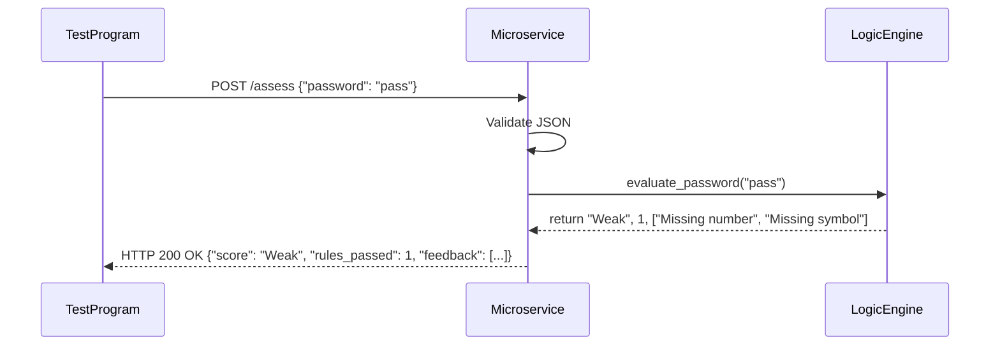

# Password Strength Assessor Microservice

## Description
This microservice evaluates the strength of a given password. It checks the password against complexity rules (length, numbers, symbols) and a list of commonly known compromised passwords. It returns a strength score and specific feedback.

## How to Request Data (Programmatic)
Other programs can request data by sending an HTTP POST request to the `/assess` endpoint using JSON. 

**Request Format:**
*   **Endpoint:** `http://localhost:5001/assess`
*   **Method:** POST
*   **Headers:** `Content-Type: application/json`
*   **Parameters:** `password` (string)

**Example Call (Python using `requests`):**
```python
import requests

url = "http://localhost:5001/assess"
payload = {"password": "MySecretPass1!"}
response = requests.post(url, json=payload)
```

